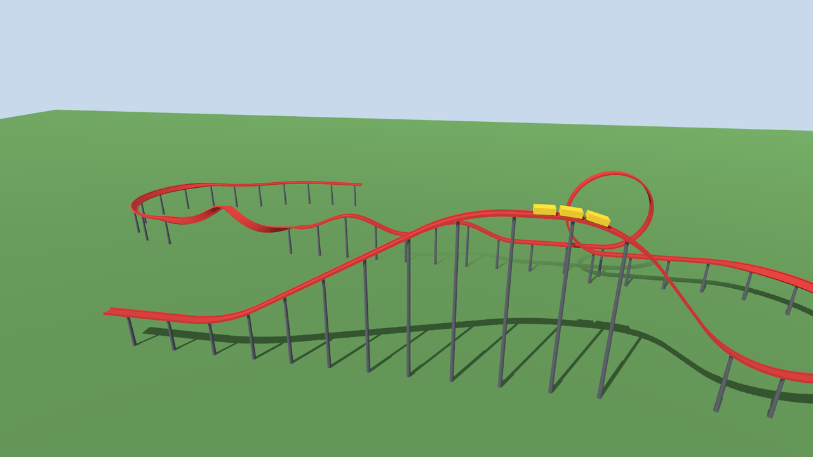
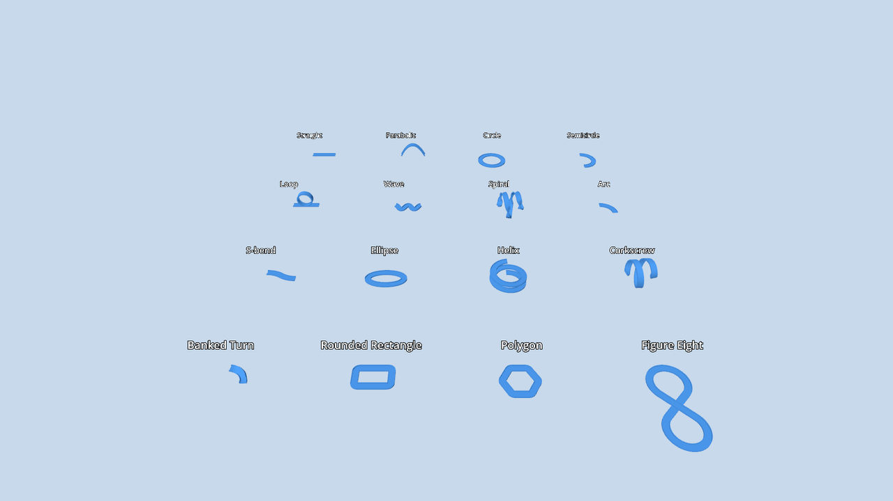
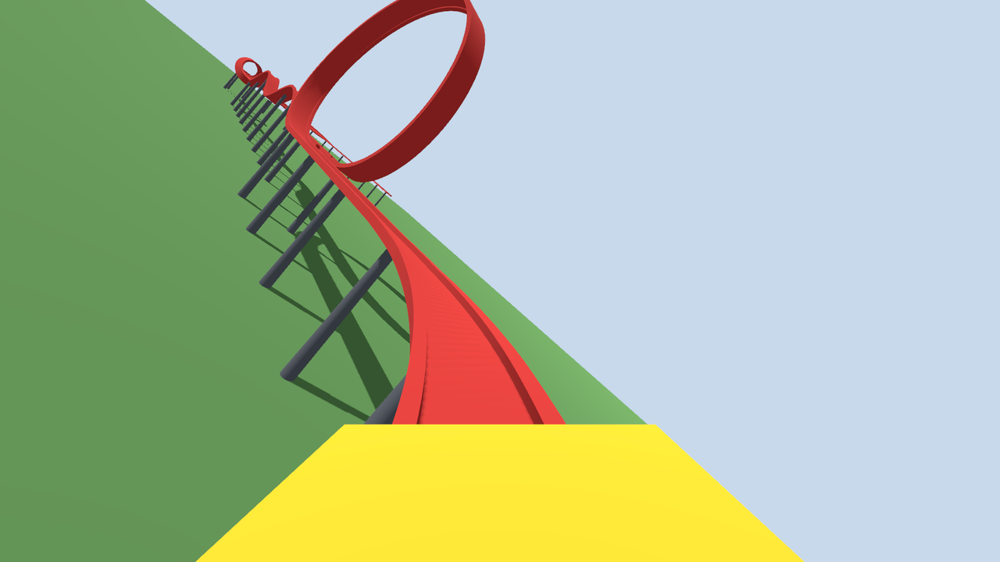
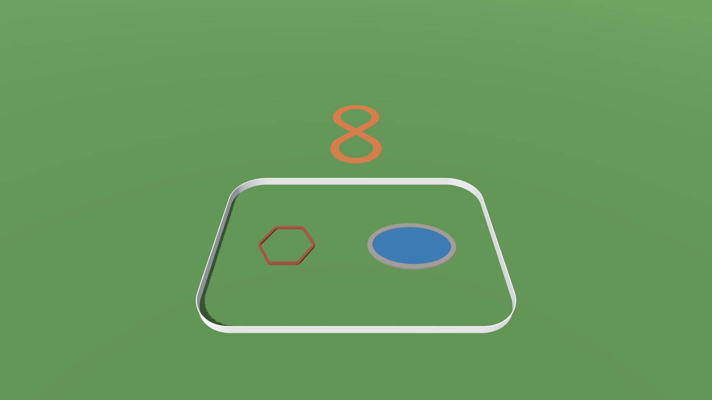

# godoocurves

Generate preset Bezier shapes on a `Path3D`, straight from the Godot editor: arcs, S-bends, waves, loops, helixes, corkscrews, banked turns and closed outlines. Each shape either replaces the path's curve or is appended at its end, so you can build a track from pieces that join without a kink. Shapes that lean, such as banked turns and corkscrews, set the curve's tilt, so a cart or a mesh along the path leans with them.

**Requirements:** Godot 4.7 or later, the **.NET** edition, and the [.NET SDK](https://dotnet.microsoft.com/download) 8.0 or later.

## Install

1. **Download** `godoocurves-<version>.zip` from the [Releases page](https://github.com/teacher-svb/Godoodads/releases) and **extract it into your project's root folder**, next to `project.godot`. It contains `addons/godoocurves/` and `addons/editor_tools_common/`. If you already have `editor_tools_common` from another Godoodads addon, let the newer copy replace it.
2. **Create a C# solution** if your project has none: *Project → Tools → C# → Create C# solution*.
3. **Build** the project (the hammer icon, or `dotnet build`).
4. **Enable** **godoocurves** in *Project → Project Settings → Plugins*.
5. **Check it works:** select a `Path3D`. The 3D viewport toolbar shows a **Path3D** button with **Generate Curve (GDDS)** in it.

## Usage

1. Select a `Path3D` and choose **Path3D → Generate Curve (GDDS)**. The dialog opens on the settings the path used last time, if any.
2. Choose a **Shape** and set its numbers. Only the settings that shape uses are shown. A pink **preview** in the viewport shows where Generate puts the shape; yellow ticks show which way is up along it.
3. Choose the **Mode**:
   - **Replace** puts the shape at **Start**, heading along **Direction**, with **Up** as its up direction. The path's old curve is replaced.
   - **Append** adds the shape at the end of the path's curve. It continues in the direction the curve ends in, and keeps its up and tilt, so the join is smooth.
4. Press **Generate**. It is one undo step, which also restores the settings stored on the path. The dialog stays open, so you can append piece after piece: a straight, a banked turn, a loop, a wave, and so on.

### Shapes

All lengths are in the path's local units. **Bend** chooses which way a shape turns, seen when heading along Direction: Left, Right, Up or Down.

| Shape | Settings | Notes |
|---|---|---|
| Straight | Length | |
| Parabolic | Length, Height | A jump arc that ends level with its start. It leaves at its slope, so it kinks when appended after a straight. A negative Height dips. |
| Circle | Radius, Bend | Closed. |
| Semicircle | Radius, Bend | Ends facing back. |
| Loop | Length, Diameter, Side Shift | A vertical loop between a straight run-in and run-out; Length runs from start to end. Side Shift moves the exit sideways so the track does not run into itself; it eases in and out, so the loop leaves and rejoins the straight without a sideways kink. |
| Wave | Length, Amplitude, Cycles, Bend | Crests of height Amplitude that start and end level. Bend Up gives hills, Left or Right a slalom. |
| Spiral | Length, Radius, Turns | Winds around the start direction, starting and ending on that axis. |
| Arc | Radius, Angle, Bend | Any angle up to 360°. |
| S-bend | Length, Offset, Bend | Two opposite arcs. Ends Offset to the side, parallel to the start. |
| Ellipse | Radius Forward, Radius Side, Bend | Closed. |
| Helix | Radius, Turns, Rise, Bend | Turns left or right while climbing Rise at a constant slope. It leaves at that slope. A negative Rise descends. |
| Corkscrew | Length, Radius, Turns | A spiral that rolls with its turn, so the track faces the axis. Turns are whole, so it ends upright. |
| Banked Turn | Radius, Angle, Bank, Bend | A level turn that banks into the curve: it eases in over the first quarter, holds, and eases out over the last quarter. |
| Rounded Rectangle | Width, Depth, Corner Radius, Bend | Closed. Corner Radius 0 gives sharp corners. |
| Polygon | Sides, Radius, Corner Radius, Bend | Closed regular polygon; Radius is to its corners. |
| Figure Eight | Radius, Bend | Closed: two round lobes joined by straights that cross at right angles. |

Closed shapes can only Replace. Nothing can be appended to a closed curve.

### Making things follow the tilt

The curve's tilt is set relative to the curve's own up vectors, which is how Godot's `CSGPolygon3D` (Path Rotation: Path Follow) and `Curve3D.sample_baked_with_rotation` use it.

For a `PathFollow3D`, use **Rotation Mode: XYZ** with **Tilt Enabled**. Do not use **Oriented**: in Godot 4.7 it orients by world up and only adds the tilt, so a cart flips over in a loop and leans wrongly after one.

## Demo

The demo scenes are in this repository under `demo/godoocurves/`. The release zip contains only the addon. Each path stores its settings, so you can open the dialog on it and carry on.

- `shapes.tscn`: every shape at its default settings.
- `coaster.tscn`: a 365 m ride appended from 15 pieces, with a deck and rails (`CSGPolygon3D`), pillars and a three-car train. **Run the scene** (F6) to ride it from the front car.
- `outlines.tscn`: closed shapes in use: a fence on a Rounded Rectangle, a flower-bed border on a Polygon, a pond rim on an Ellipse, and a running track on a Figure Eight.

`demo/godoocurves/tools/build_demo.tscn` rebuilds all three with the addon's own code: `godot --headless --path . res://demo/godoocurves/tools/build_demo.tscn`.

## Good to know

- Generate gives the path **its own curve**. A `Curve3D` that several paths share, or one saved as a `.tres` file, is never changed. The status says so when the old curve was a file.
- Generated points are in the path's local space, so a rotated or scaled `Path3D` rotates or scales the shape with it.
- The preview has no owner, so it is never saved with the scene.
- The shape, settings and math are documented in the brief, [docs/briefs/godoocurves.md](../../docs/briefs/godoocurves.md).
