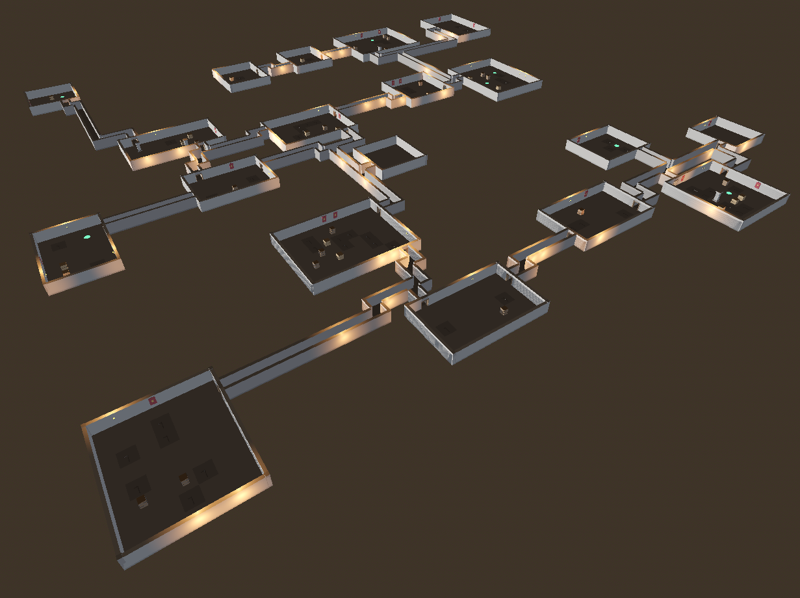
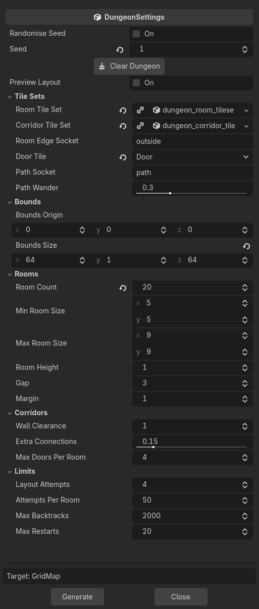

# godoodungeon

Generate dungeons on a `GridMap`, straight from the Godot editor. godoodungeon lays out rooms and their doors, fills every room with modules using wave function collapse, and joins the rooms with corridors that run from door to door. You choose a box of cells, two tile sets and a few numbers, then press **Generate**. Cells you placed by hand stay where they are, and the dungeon works around them.



**Requirements:** Godot 4.7 or later, the **.NET** edition (the download labelled ".NET" or "mono"), and the [.NET SDK](https://dotnet.microsoft.com/download) 8.0 or later.

## Install

1. **Download** `godoodungeon-<version>.zip` from the [Releases page](https://github.com/teacher-svb/Godoodads/releases). Pick the newest release whose name starts with `godoodungeon`.
2. **Extract it into your project's root folder**, the folder that holds `project.godot`. The zip contains two folders, which end up as:
   ```
   your_project/
   ├── project.godot
   └── addons/
       ├── editor_tools_common/   shared helpers and the WFC solver of the Godoodads addons
       └── godoodungeon/
   ```
   If your project already has `addons/editor_tools_common/` from another Godoodads addon, let the newer copy replace it.
3. **Create a C# solution** if your project has none yet: *Project → Tools → C# → Create C# solution*. Skip this if your project already has a `.csproj` file.
4. **Build** the project with the hammer icon at the top right of the editor, or run `dotnet build` in the project folder.
5. **Enable the plugin** in *Project → Project Settings → Plugins* by ticking **godoodungeon**.
6. **Check it works:** select a `GridMap` node. The 3D viewport toolbar shows a **GridMap** menu with **Generate Dungeon (GDDS)** in it.

To try it straight away, the demo scenes are in this repository under `demo/godoodungeon/` (see [Demo](#demo)). The zip contains only the addon.

### With godoowave

godoodungeon uses the same solver and tile set resources as [godoowave](../godoowave/README.md) (called WFC Generator up to 1.3.3), from `addons/editor_tools_common/Wfc/`. You do not need godoowave, but both can be enabled at once: their items share the **GridMap** menu, and a tile set shows one preview. If the older WFC Generator is installed instead, it must be **1.3.3 or later**. Older versions keep their own copy of the tile set classes, so tile sets would load as types godoodungeon cannot use. godoodungeon warns when it finds an older version.

### Updating

Close Godot, delete `addons/godoodungeon/`, then extract the new zip as above, and let its `editor_tools_common` replace yours. Build again before you reopen the dialog. The CHANGELOG lists what changed.

### If something goes wrong

| Problem | Fix |
|---|---|
| godoodungeon is not in the plugin list | The files are one level too deep. The plugin must be at `addons/godoodungeon/plugin.cfg`, not `addons/addons/…` or `godoodungeon-1.0.0/addons/…`. |
| "Unable to load addon script" when enabling it | The C# project has not been built yet, or the build failed. Build (step 4), read the errors in the MSBuild panel at the bottom of the editor, then enable the plugin again. |
| Build errors about types defined twice, or "UID duplicate detected" warnings | An older WFC Generator (1.3.2 or earlier) is installed next to it. Replace it with godoowave, deleting `addons/wfc_generator/` first. |
| No GridMap menu in the toolbar | Select a `GridMap` node; the menu only appears for GridMaps. |
| After a rebuild, the editor still runs the old code | Godot reloads C# when its window gets focus. Click into the editor window, then disable and enable the plugin. |
| The first Generate after a rebuild takes about a second | .NET compiles the code on first use after a rebuild. Later runs are fast. |

## Use

1. Make a **room tile set** and a **corridor tile set**: two `WfcTileSet` resources that use the GridMap's `MeshLibrary` (see [Tile sets](#tile-sets)). The demo tile sets in `demo/godoodungeon/assets/` are a good start.
2. Select the `GridMap`.
3. In the 3D viewport toolbar, open **GridMap → Generate Dungeon (GDDS)**. GDDS is short for Godoodads, the suite this addon belongs to.
4. Choose the **Room Tile Set**, the **Corridor Tile Set** and the **Door Tile**, and set the **Bounds**, which are drawn in violet in the viewport. Drag the handles on its faces to resize it.
5. Tick **Preview Layout** to see the rooms (cyan), doors (yellow) and corridors (green) that Generate will make, and tune the numbers or the seed until you like the layout.
6. Press **Generate**.



Generate runs in the background and takes a fraction of a second for a 64 × 64 dungeon. Press **Stop** to cancel; the GridMap is then left exactly as it was. Each generation is one undo step (Ctrl+Z). The settings are saved on the GridMap, so reopening the dialog restores them, and the scene file can reproduce the dungeon. The status area shows the result:

```
Generated 19 rooms, 31 doors and 21 corridors in 0.1 s, written in 0.0 s. Seed 1.
Placed 19 of 20 rooms: 1 found no free place. Enlarge the bounds, or lower the room count, the room sizes or the gap.
Placed 66 markers in DungeonMarkers.
```

Generate again, with another seed or other settings, to replace the dungeon. **Clear Dungeon** removes it as one undo step.

### Cells you place yourself

Occupied cells inside the bounds that the last dungeon did not write are yours. Rooms keep the **Gap** away from them, corridors go around them, and Generate and Clear Dungeon never change them. Use this for set pieces such as a statue or a pool. They are obstacles: the dungeon goes around them and does not connect to them. A generated cell that you edit afterwards becomes yours too, so the next Generate keeps it.

### Markers

A tile can carry a **Marker** scene (a light, a spawn point), as in godoowave. After Generate, it is placed at every cell where that tile was generated, in a `DungeonMarkers` node under the GridMap. The next Generate or Clear Dungeon replaces the markers on the cells it changes. Move a marker out of `DungeonMarkers` to keep it.

## Options

| Option | Default | Meaning |
|---|---|---|
| Randomise Seed | off | Generate picks a new seed first. Off keeps the seed, so Generate repeats its result. |
| Seed | 0 | The seed of the next Generate. Everything (rooms, doors, corridors, tiles) follows from it. |
| Clear Dungeon | | Removes the cells and markers of the last dungeon, as one undo step. Cells you placed or edited stay. |
| Preview Layout | off | Draws the rooms, doors and corridors Generate would make, without generating. |
| **Tile Sets** | | |
| Room Tile Set | | Floors, walls, corners, doors and props. |
| Corridor Tile Set | | Corridor pieces and an empty tile. |
| Room Edge Socket | `outside` | The socket name of faces that point out of a room. Tiles use `outside+`; the room bounds supply `outside-`. |
| Door Tile | | The room tile placed at every door. |
| Path Socket | `path` | The socket of the corridor tiles' open faces. |
| Path Wander | 0.3 | 0 gives the most direct corridors, 1 the most meandering. |
| **Bounds** | | |
| Bounds Origin, Bounds Size | 0, 48 × 1 × 48 | The box the dungeon fills. X and Z hold the dungeon, Y the room layers from the bottom. Corridors use the bottom layer. |
| **Rooms** | | |
| Room Count | 12 | How many rooms to place. Rooms that find no free place are left out, and the status says so. |
| Min / Max Room Size | 5 × 5 / 9 × 9 | Room size on X and Z, walls included. At least 3 × 3. |
| Room Height | 1 | Room layers. |
| Gap | 3 | Free cells between rooms, and between rooms and your cells. At least 2 × Wall Clearance + 1, and at least 2. |
| Margin | 1 | Free cells between rooms and the edge of the bounds. |
| **Corridors** | | |
| Wall Clearance | 1 | Cells around each room that corridors keep free, except outside the doors. 0 lets corridors run along room walls. |
| Extra Connections | 0.15 | Loops per tree edge of the room graph: 0 gives a tree of rooms, 1 one loop per connection. |
| Max Doors Per Room | 4 | A room never gets more doors; further connections share an existing door. |
| **Limits** | | |
| Layout Attempts | 4 | Whole layouts tried, each from a seed derived from yours, before Generate gives up. |
| Attempts Per Room | 50 | Positions tried per room before it is left out. |
| Max Backtracks, Max Restarts | 2000, 20 | Limits of each room and corridor solve, as in godoowave. |

## Tile sets

Both tile sets are ordinary `WfcTileSet` resources ([godoowave](../godoowave/README.md#tile-sets) explains tiles, sockets, rotations and weights). They must use the same `MeshLibrary` as the GridMap. Build walls **inside** the cell, on its outer edge: a corridor that passes next to a room then shows its own wall beside the room's, not inside it.

### Room tile set

| Face | Socket | Example (demo) |
|---|---|---|
| Between two interior cells | any matching label | `in` |
| Along a wall, between wall, corner and door tiles | any matching label | `edge` |
| Pointing out of the room | the room edge socket with `+` | `outside+` |

- The room edge socket must be **one-sided**: tiles use `outside+`, and the room bounds supply `outside-`. A plain `outside` would let two walls meet inside a room.
- Add `outside-` to the room tile set's **External Sockets**. The room bounds supply it, so the tile set check and the preview then count it as a partner instead of marking every wall face red.
- The **Door Tile** has exactly one `outside+` face, its outside. Give it weight 0, so only the layout places doors.
- Walls, corners and doors need four rotations.

### Corridor tile set

- Open faces use the **path socket** (`path`); closed faces and the empty tile use another label (`x`).
- Every piece a corridor can be made of, in four rotations: a **straight**, a **bend**, a **T** and a **cross**. There is no dead end; corridors always run from door to door.
- An **empty** tile, with no path faces and a weight above 0, fills the space between corridors. Its item may be *Empty*.
- Variants with the same path faces (a straight with a torch, say) are picked by weight.

godoodungeon checks all of this before generating and names what is missing.

## When generation fails

- **The dungeon cannot be generated with these settings.** A setting or a tile set rule is wrong. Each problem is listed with what to change.
- **No layout could be generated in n attempts.** Each attempt is listed: a room that could not be solved, or a corridor that could not join two doors because rooms, their clearance and your cells close every way. Red boxes in the viewport mark where. Move your cells, lower the Gap or Wall Clearance, or enlarge the bounds.
- **The dungeon was generated, but failed its connectivity check.** This is a bug: please report it with the seed and settings. The unreachable rooms are marked red.

In every case the GridMap is left unchanged. With Randomise Seed on, a failed seed is put back and not tried again.

## How it works

1. **Rooms** are placed one at a time at random sizes and positions, keeping the gap from each other and from your cells.
2. **Room graph:** a minimum spanning tree over the room centres connects every room; Extra Connections adds the shortest remaining connections as loops.
3. **Doors** go on the side of a room that faces each neighbour, at the wall cell closest to it, one door per side at most.
4. Each **room** is solved with WFC: the room's bounds supply `outside-` on all sides, which forces walls around it, and its doors are fixed.
5. **Corridors** are routed along the room graph, one per connection, from door to door, around rooms and their clearance. Corridors that meet merge into T pieces; corridors avoid running side by side.
6. The **corridor** cells are solved with WFC: routed cells may only use corridor pieces with exactly their openings, other cells only pieces without openings.
7. A **connectivity check** walks from the first room through doors and corridors and must reach every room.
8. The cells, markers and settings are written as one undoable action.

Steps 1 to 7 run on a background thread. A room or corridor that cannot be solved starts the next layout attempt.

**Performance** (64 × 64, 20 rooms, demo tile sets): about 10 ms to generate; writing into the GridMap takes up to about 0.4 s in the editor when it replaces a previous dungeon and its markers. 128 × 128 with 60 rooms generates in about 50 ms. Every one of 20 seeds solves first time in both demo scenes.

## Demo

`demo/godoodungeon/dungeon_free.tscn` is an empty 64 × 64 GridMap set up for 20 rooms. `dungeon_obstacles.tscn` is the same with five statues and a pool placed by hand, which the dungeon works around. Select the GridMap, open the dialog and press Generate. Both use the dungeon tile sets in `demo/godoodungeon/assets/`, with torch markers on some walls and corridors and spawn markers in some rooms. `demo/godoodungeon/tools/build_demo.tscn` rebuilds the MeshLibrary, the tile sets and both scenes.

## Limitations

- Editor-only. There is no runtime generation yet.
- One floor: rooms stand on the bottom layer of the bounds, and corridors do not climb.
- Rooms are rectangles, generated from the room tile set. Cells you place by hand are obstacles; a hand-built room is not connected to the dungeon.
- No room roles (start, boss, treasure) or progression such as locks and keys.
- 3D `GridMap` only.
