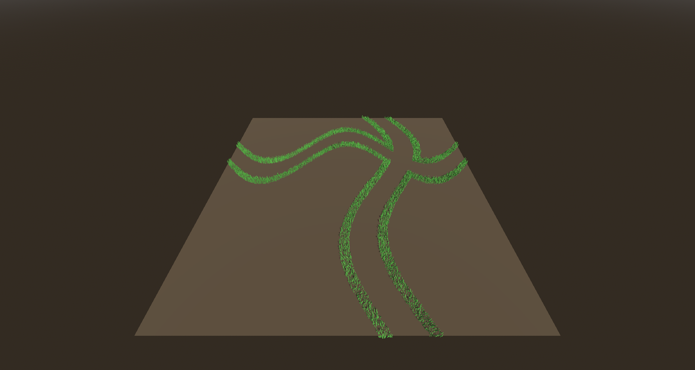
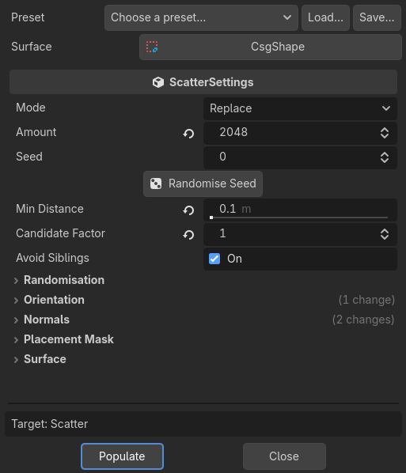
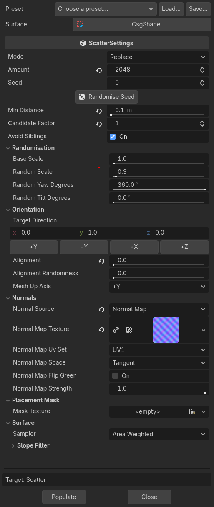
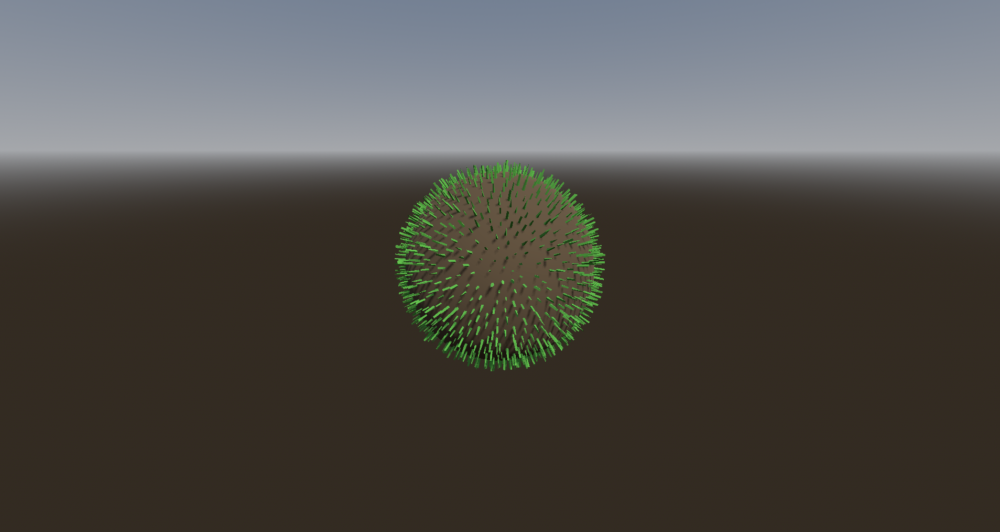
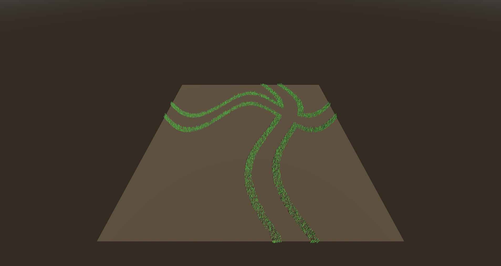
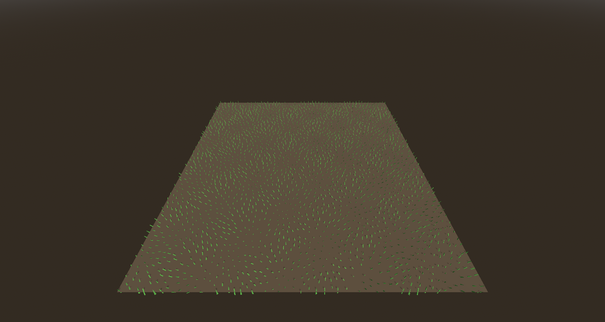
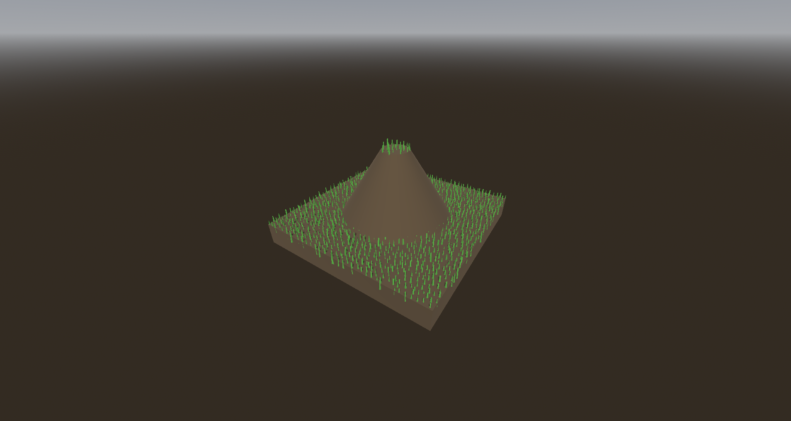

# MultiMesh Scatter

Fill a `MultiMeshInstance3D` with instances placed on a surface mesh, straight from the Godot editor. Placement can follow the surface geometry, a black and white mask texture, a normal map, or any combination.



**Requirements:** Godot 4.7 or later, .NET build.

## Install

Requires the **.NET edition** of Godot 4.7 or later and the .NET SDK 8.0 or later.

1. Download `multimesh_scatter-<version>.zip` from the [Releases](https://github.com/teacher-svb/Godoodads/releases) page.
2. Extract it into your project's root folder, next to `project.godot`. It contains `addons/multimesh_scatter/` and the shared `addons/editor_tools_common/`; if another Godoodads addon already installed an older `editor_tools_common`, let the newer one replace it.
3. If your project has no C# solution yet, create one with *Project → Tools → C# → Create C# solution*.
4. Build the C# project (the hammer icon, or `dotnet build`).
5. Enable **MultiMesh Scatter** in *Project → Project Settings → Plugins*.

If the addon is missing from the plugin list, the zip was extracted one folder too deep: the file must be at `addons/multimesh_scatter/plugin.cfg`. If enabling it reports "Unable to load addon script", build first and check the MSBuild panel for errors. To update, close Godot, delete `addons/multimesh_scatter/`, extract the new zip and build.

## Use

1. Select a `MultiMeshInstance3D`. Its MultiMesh needs a mesh, such as a grass blade or a rock.
2. In the 3D viewport toolbar, open **MultiMesh → Populate Surface (GDDS)**. GDDS is short for Godoodads, the suite this addon belongs to. Godot's own tool sits next to it, labelled *Populate Surface (Godot)* while the plugin is enabled.
3. Pick a **Surface**: a `MeshInstance3D`, the outermost (root) CSG node, or a `GridMap`.
4. Adjust the settings, or pick a **Preset**, then press **Populate**.



Each populate is one undo step (Ctrl+Z). The settings are saved on the node, so reopening the dialog restores them and the scene file can reproduce the result. The dialog stays open, and the status area shows the result:

```
Placed 2048 / 2048. Seed 803429914. 6 ms.
Mask rejected 2076 of 4124 tried positions (50%).
```

### GridMap surfaces

A `GridMap` works as a surface too: every used cell's item mesh counts, placed exactly as GridMap draws it. Faces hidden between tiles are left out, so nothing is scattered inside stacked blocks: a triangle that lies on the outer face of its cell is skipped when the neighbouring cell on that side holds any item. Faces inside a cell, such as a ramp's slope or a post's sides, always count. Your `MeshLibrary` is only read.

With a GridMap picked, the dialog shows a **GridMap** group:

- **Items** and **Item Mode**: the item names to use (**Include**) or to skip (**Exclude**). Empty uses every item. For example, exclude `Paving` to keep grass off the paths.
- **Box Origin** and **Box Size**: only the cells in this box, in GridMap cells. A size of 0 uses the whole map. Neighbours outside the box still hide faces.

The status area adds a line such as `Read 165 GridMap cells; left out 1,288 triangles covered by neighbouring cells.` The slope filter works as usual, so a maximum of about 50° keeps instances on tops and ramps.

### One mask over the whole surface

By default a mask is sampled at each point's UV, so on a GridMap it repeats on every tile. Set **Placement Mask → Projection** to **Top Down** to lay the mask over the surface from above instead: the image covers the surface's area seen from above (or the GridMap's cell box, when set), with +X to the right of the image and +Z down. One painted mask can then cover a whole GridMap, or any mesh without good UVs.

## Options



| Group | Option | What it does |
|---|---|---|
| — | Mode | **Replace** the current instances, or **Append** to them, for example to scatter several surfaces into one MultiMesh. |
| — | Amount | Number of instances to place. |
| — | Seed, Randomise Seed | Same seed and settings give the same result. In Append mode the existing instance count is mixed in, so repeated appends do not overlap. |
| — | Min Distance | Hard minimum distance between instances; 0 is off. Also keeps distance from existing instances in Append mode. |
| | Candidate Factor | Candidates generated per instance before thinning. Higher spreads more evenly but is slower. |
| | Avoid Siblings | Also keep distance from instances of sibling `MultiMeshInstance3D` and `MeshInstance3D` nodes. |
| Randomisation | Base Scale, Random Scale | Scale is Base ± Random. |
| | Random Yaw, Random Tilt | Random rotation around the instance's own up axis, then a random tilt. |
| Orientation | Target Direction, +Y / -Y / +X / +Z | Direction V that the instances point to at alignment 1. |
| | Alignment | 0 follows the surface normal, 1 follows the target direction; values in between blend (slerp). |
| | Alignment Randomness | Random offset per instance on Alignment, up to this amount either way. |
| | Mesh Up Axis | The axis of your instanced mesh that counts as "up", for assets that are not modelled Y-up. |
| Normals | Normal Source | **Face** (flat per triangle), **Smooth** (interpolated vertex normals) or **Normal Map**. |
| | Normal map options | Texture, UV set, **Tangent** or **Object** space, **Flip Green** (for DirectX-style maps; Godot expects OpenGL Y+), **Strength** (0 = ignore the map, 1 = full map normal). |
| Placement Mask | Mask Texture | Black and white texture sampled at each position's UV. Empty means no mask. |
| | Channel | Luminance, R, G, B or A. |
| | Projection | **UV**: at each position's UV. **Top Down**: projected from above over the surface (see above). |
| | UV Set | UV1 or UV2 (UV projection only). |
| | Mode | **Threshold**: place where the value is at least the threshold. **Density**: place with a probability equal to the value, so grey is sparser. |
| | Threshold, Invert | Threshold applies to Threshold mode only. Invert swaps black and white. |
| Surface | Sampler | **Area Weighted**: even density per square metre (measured in world space, so scaled surfaces stay even). **Uniform Per Triangle**: denser where triangles are small. |
| Surface → Slope Filter | Min / Max Degrees | Place only where the angle between the face normal and the reference lies in this range. 0–180 means no filtering. |
| | Reference, Custom Direction | Measure against the target direction, or against a custom vector. |
| GridMap | Items, Item Mode | GridMap surfaces only: the item names to include or exclude. Empty uses all. |
| | Box Origin, Box Size | GridMap surfaces only: the cells to use. A size of 0 uses the whole map. |

## Presets

Use the **Preset** row to pick a shipped preset, **Load…** any `.tres` preset, or **Save…** the current settings. Loading a preset keeps your chosen surface.

| Preset | Settings |
|---|---|
| Upward faces (legacy) | Face normals, always upright, slope 0–45° from +Y. Matches the original *UpFaceMultiMesh* plugin. |
| Follow surface | Smooth normals, alignment 0: instances stand along the surface normal. |
| Grass on terrain | Smooth normals, alignment 0.7 ± 0.15, tilt 8°, slope 0–40°, min distance 0.15. |
| Masked scatter | Density mask mode and min distance 0.1. Add your own mask texture. |

## How it works

Every option is an independent stage of one pipeline, run in this order:

1. **Surface data.** All surfaces of the mesh, indexed or not, are read in world space, with normals, UVs and tangents. For a GridMap, each item mesh is read once and placed per cell, and triangles on covered cell faces are left out.
2. **Triangle sampler.** Triangles are picked by area (alias method) and points are chosen uniformly inside them. The slope filter removes triangles before sampling.
3. **Mask filter.** Rejected positions are retried, up to Amount × 20 attempts, and any shortfall is reported.
4. **Normal source and orientation.** Instance up = slerp(N, V, alignment).
5. **Randomisation.** Yaw around the instance's own up, then tilt, scale and position.
6. **Spacing.** Sample elimination (Yuksel 2015) generates about 5× more candidates and repeatedly removes the most crowded one. Min Distance is a hard limit, and any shortfall is reported.
7. **Write.** The MultiMesh is copied (its mesh and its `use_colors` / `use_custom_data` settings are kept), filled with one buffer write, and swapped in as one undoable action.

Normal maps use the same formulas as Godot's own renderer, so instances lean the way the surface is lit. If a mesh has no tangents (Godot stores placeholder tangents for such meshes), real tangents are generated on a temporary copy. Your meshes and textures are never modified.

**Performance** (100,352 triangles, 50,000 instances, full path): about 0.15 s without Min Distance and 2.1 s with it.

## Gallery

| Follow surface | Placement mask |
|---|---|
|  |  |
| **Normal map** | **Upward faces (legacy)** |
|  |  |

The demo scenes live in `demo/multimesh_scatter/`. `demo_gridmap.tscn` scatters grass on a small GridMap: on open tops and ramps, not on the paving strip or between stacked blocks, with the paths mask projected from above.

## Limitations

- Editor-only. There is no runtime scattering node yet.
- Tangent-space normal maps need UV1, because mesh tangents are built from UV1.
- Object-space normal maps need all three colour channels. Godot's default normal-map import (BC5, red and green only) works for tangent space only.
- Minimum distance is measured in 3D. On thin walls it also separates instances on opposite sides.
- On a GridMap, a face is hidden only when it lies exactly on its cell's outer face and the neighbouring cell holds an item, whatever that item's shape. A smaller tile next to a block therefore hides the block's whole face.
- Top Down projection always looks along -Y, in world space.
