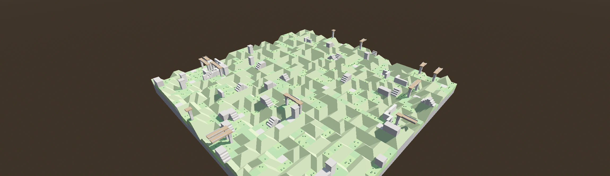
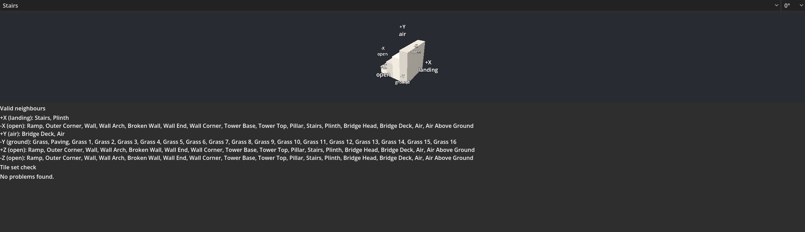

# WFC Generator

Fill a `GridMap` with modules using wave function collapse, straight from the Godot editor. You describe which modules may sit next to each other by labelling their faces with sockets, choose a box of cells, and press **Generate**. Generation works in true 3D, so modules stack and connect vertically as well as horizontally.



**Requirements:** Godot 4.7 or later, the **.NET** edition (the download labelled ".NET" or "mono"), and the [.NET SDK](https://dotnet.microsoft.com/download) 8.0 or later.

## Install

1. **Download** `wfc_generator-<version>.zip` from the [Releases page](https://github.com/teacher-svb/Godoodads/releases). Pick the newest release whose name starts with `wfc_generator`.
2. **Extract it into your project's root folder**, the folder that holds `project.godot`. The zip contains two folders, which end up as:
   ```
   your_project/
   ├── project.godot
   └── addons/
       ├── editor_tools_common/   shared helpers of the Godoodads addons
       └── wfc_generator/
   ```
   If your project already has `addons/editor_tools_common/` from another Godoodads addon, let the newer copy replace it.
3. **Create a C# solution** if your project has none yet: *Project → Tools → C# → Create C# solution*. Skip this if your project already has a `.csproj` file.
4. **Build** the project with the hammer icon at the top right of the editor, or run `dotnet build` in the project folder.
5. **Enable the plugin** in *Project → Project Settings → Plugins* by ticking **WFC Generator**.
6. **Check it works:** select a `GridMap` node. The 3D viewport toolbar shows a **GridMap** menu with **Generate WFC (GDDS)** in it.

To try it straight away, the demo scenes are in this repository under `demo/wfc_generator/` (see [Demo](#demo)); the zip contains only the addon.

### Updating

Close Godot, delete `addons/wfc_generator/`, then extract the new zip as above, so files removed in the new version do not linger. Build again before you reopen the dialog. Scenes and tile sets from older versions keep working; the CHANGELOG lists what changed.

### If something goes wrong

| Problem | Fix |
|---|---|
| WFC Generator is not in the plugin list | The files are one level too deep. The plugin must be at `addons/wfc_generator/plugin.cfg`, not `addons/addons/…` or `wfc_generator-1.2.0/addons/…`. |
| "Unable to load addon script" when enabling it | The C# project has not been built yet, or the build failed. Build (step 4), read the errors in the MSBuild panel at the bottom of the editor, then enable the plugin again. |
| Build error about a missing SDK or framework | Install the .NET SDK 8.0 or later, then restart Godot. |
| No GridMap menu in the toolbar | Select a `GridMap` node; the menu only appears for GridMaps. |
| After a rebuild, the editor still runs the old code | Godot reloads C# when its window gets focus. Click into the editor window, then disable and enable the plugin. |

## Use

1. Create a **tile set**: a `WfcTileSet` resource that points at your `MeshLibrary` and lists the sockets of each module (see below).
2. Select a `GridMap` that uses the same `MeshLibrary`.
3. In the 3D viewport toolbar, open **GridMap → Generate WFC (GDDS)**. GDDS is short for Godoodads, the suite this addon belongs to.
4. Choose the **Tile Set** and the **Bounds**, which are drawn in orange in the viewport, then press **Generate**.

The solve runs in the background, and you can watch the cells fill in. Press **Stop** to cancel; the GridMap is then left exactly as it was. Each generation is one undo step (Ctrl+Z). The settings are saved on the GridMap, so reopening the dialog restores them and the scene file can reproduce the result. The status area shows the result:

```
Solved 160,000 cells in 3.9 s (0 backtracks, 0 restarts). Seed 7.
Kept 10,000 existing cells.
```

### Cells you place yourself

Cells already in the bounds stay where they are, and the solve fills in around them. Use this to paint a ground layer, a road or a landmark first. Turn on **Clear Bounds First** to replace everything instead.

A cell whose item has no tile, or whose rotation is not one the tile allows, is left alone and does not constrain its neighbours. The status area reports how many there were.

**Generate replaces the previous result.** The GridMap remembers which cells the last generation wrote, so pressing Generate again with another seed replaces them, without undoing first. Cells you placed yourself stay. A generated cell that you changed since (another item or rotation) counts as placed by you and stays too. The status area reports how many cells were replaced and how many edited cells were kept. What was written is stored compressed in the GridMap's metadata (about 20 KB for 100 × 16 × 100 cells) and is part of the undo step.

**Pin cells to keep them.** To keep a good part of a result while regenerating the rest, press **Pin Box → Place Around Bounds**, drag the blue box over that part, and press **Pin Generated Cells**. Pinned cells count as placed by you until you press **Unpin**.

### Boxes in the viewport

While the dialog is open, the bounds (orange) and the pin box (blue) are drawn in the 3D viewport. With the GridMap selected, drag the dots on their faces to resize them by whole cells. Each drag is one undo step; right-click or Escape cancels it. Clicks away from the dots still paint the GridMap as usual.

### Paths between placed cells

Give some tiles **path faces**: faces whose socket has one name, such as `path` (`path+`, `path-` and `path@0` count too). Set **Paths → Socket** to that name, place two or more path cells by hand, for example two path ends, and press Generate. Before solving, a route is laid through the empty cells between them, and the solve then fills in the path tiles and everything around them, so the path is always connected and always fits.

- Every open path face of a placed cell gets a route. Two ends give one path; three or more give branches, joined through a T or cross tile. A path face pointing out of the bounds counts as connected, so a path can run off the edge.
- A route only takes steps the tile set allows: a turn needs a corner tile, a branch a T tile, and a climb a tile with a path face on top (or below). The demo's path stairs have path faces on their low side and on top, and the empty cell above them has path faces below and towards the high side.
- With paths on, path tiles appear only on routes.
- **Paths → Wander** goes from 0 (the shortest route) to 1 (meandering). The seed decides the route.
- If the tiles around a route cannot be filled in, up to 8 other routes are tried. The status area reports how many routes were laid and over how many cells.
- Route cells are generated cells: Generate lays a new route, and pinning keeps a path you like.

## Options

| Option | What it does |
|---|---|
| Tile Set | The `WfcTileSet` to generate with. Its `MeshLibrary` must be the GridMap's. |
| Seed, Randomise Seed | The same seed, settings and placed cells give the same result. |
| Clear Bounds First | Removes everything in the bounds before solving, including cells you placed. Otherwise placed cells are kept. |
| Bounds → Origin, Size | The box of cells to fill, in GridMap cell coordinates. You can also drag its handles in the viewport. |
| Pin Box → Origin, Size, buttons | A second box for pinning generated cells (see above). A size of 0 hides it. |
| Boundary → Pos X … Neg Z | Optional socket per face of the bounds, as if a fixed neighbour with that socket sat outside it. For example `rock` on Neg Y gives a solid floor without painting a ground layer. Empty leaves the face unconstrained. |
| Paths → Socket | The socket name of path faces, such as `path`. Placed cells with path faces are joined by routes before solving (see above). Empty turns paths off. |
| Paths → Wander | 0 gives the shortest routes, 1 the most meandering. |
| Animation → Cells Per Frame | How fast the solve is shown. 0 shows only the final result. The result never depends on this. About 1,000 keeps the editor responsive. |
| Solver Limits → Max Backtracks | Backtracks allowed per attempt before starting over with a new seed derived from yours. |
| Solver Limits → Max Restarts | Attempts after the first one before giving up. |

## Tile sets

A `WfcTileSet` holds a `MeshLibrary` and a list of `WfcTile` entries. The rules live in the tile set; your `MeshLibrary` is never modified.

| Tile field | What it does |
|---|---|
| Item | The MeshLibrary item this tile places, or -1 for an empty tile (air). |
| Rotation | **None**, **Half Turn** (0° and 180°) or **Quarter Turns** (all four). Rotations whose sockets are identical are merged. Straight pieces such as walls need Quarter Turns to run in both directions. |
| Weight | How often the tile is chosen, relative to the others (default 1). The weight is shared by the tile's rotations, so a ramp with Quarter Turns and weight 1 is as common as a plain block with weight 1. 0 means the solver never chooses the tile, but you can still place it by hand. |
| Height Curve | Optional. Multiplies the weight by height: the curve's start is the bottom layer of the bounds, its end the top layer. 0 at a height means the tile is never generated there. |
| Marker | Optional scene placed at every cell this tile is generated in, rotated with it, such as a light, a spawn point or a trigger. It works on empty tiles too. |
| Sockets | One label per face: +X, -X, +Y, -Y, +Z, -Z, as the module is modelled. |

The tile set's inspector shows a preview: the selected tile in 3D with its socket labels (drag to orbit), its weight and share of the total, the tiles allowed next to each face, and a check for problems.

- **Edit sockets in the preview.** Click a face label to change it. The list suggests the labels already used in the tile set, including the partner of a one-sided label. On a rotated variant, the edit goes to the face of the tile itself. Each edit is one undo step. A label shown in red is one no tile can face.
- **Measure the real shares.** Under **Tile shares**, press **Measure** to see how much of a sample result each tile really covers, next to its share of the weights (see [Measuring tile shares](#measuring-tile-shares)).



### Sockets

Two facing sockets connect when their labels match:

| Face | Label | Connects to |
|---|---|---|
| Side, symmetric | `path` | `path` |
| Side, one-sided | `path+` | `path-`, and the other way round |
| Top or bottom | `stair` | `stair`, in any rotation |
| Top or bottom, rotation-specific | `stair@0` to `stair@3` | the same label with the same number, after the tile's rotation is applied |

Labels use letters, digits and underscores. Every face needs a label.

### Designing a tile set

- **Give empty space real tiles.** Air is a tile with Item -1. A useful pattern: one air tile that rests on `ground` and one that rests on `air`, so modules can only stand on surfaces you mark as `ground`, and nothing floats.
- **Control density with weights.** Heavy empty tiles keep a map open; the demo gives each air tile weight 40, against 1 to 5 for the modules. Weight also decides which cells are filled first (see How it works), so it shapes the terrain, not only how often a tile appears. A tile of weight 3 behaves like three copies of weight 1, so copies are no longer needed. Extra variants with their own items, such as several grass tiles, are still useful for looks.
- **Keep requirements local.** Rules only see direct neighbours. A bridge that may run for any length but must end on a pillar often fails at large sizes. Give it a fixed length instead (head, deck, deck, head), using one-sided sockets so a deck can only meet a head at its outer end.
- **Use one-sided sockets for direction.** `span+` against `span-` stops a module from connecting to a rotated copy of itself.
- **Anchor the ground.** Edges are unconstrained unless you set a boundary socket, so empty columns can reach the bottom. Set the bottom boundary to a socket only ground tiles offer (the demo uses `rock`), paint a ground layer, or design sockets that keep air above ground.
- **Path tiles need Quarter Turns.** A straight path with Half Turn has only 0° and 180°, which are the same, so it cannot run along Z. Keep path tiles in a tile set used with paths on, or they appear anywhere like other tiles.
- **Climbs need room.** The cells beside a climbing tile must fit whatever is next to it. In the demo, path stairs are cut into a ramp, so the slope can go on beside them; stairs with open sides could never meet the edge of a hill.
- **Shape by height.** A height curve that falls to 0 near the top keeps heavy modules low; one that rises keeps towers and lights high.

### The tile set check

| Message | Meaning |
|---|---|
| Socket has no partner | No tile in any rotation can face this socket. The tile can only appear where that face is at the edge of the bounds. |
| Only fits at the edges of the grid | The tile depends on tiles that cannot be placed themselves. |

### Measuring tile shares

Weights look like they set the mix of tiles directly: a tile with 10% of the total weight should cover about 10% of the map. In practice the result can be far off, for two reasons:

- **Weights do two jobs.** They decide which tile a cell gets, but also which cell is filled next: the cell with the least weight left goes first. So weights shape the order the map is built in, and with it the room left for everything else.
- **Sockets limit where a tile fits.** A tile can have a large weight and still be rare because it seldom fits: a tower top only sits on a tower base.

The share shown next to a tile's weight is what you asked for. **Measure** shows what you get:

1. Set the sample size (16 × 8 × 16 by default) and the seed under **Tile shares**, and press **Measure**.
2. An empty grid of that size is solved with the tile set, in the background, so you can keep working. Press **Stop** to cancel. Changing the tile set cancels it too, because the result would describe the old tile set.
3. Each tile shows **weight share / measured share**, for example `Grass: 12.0% / 30.1%`, most common first. A line is red when the two differ more than twice, either way: that tile is much more or much less common than its weight suggests.
4. A tile with a height curve also shows its share in the bottom, middle and top third of the sample, so you can check the curve does what you meant.

If the sample cannot be solved, the failure is shown instead. Change a weight, measure again, and compare.

The result is an estimate: one sample with one seed, without boundary sockets, placed cells or paths. Another seed or size gives somewhat different numbers, and your scene's settings (a `rock` floor, for example) change the mix too. Larger samples give steadier numbers but take longer.

## When a solve fails

- **No solution exists with the cells already in the bounds.** Two placed cells do not fit together, a placed cell cannot face a boundary socket, or nothing fits between them. The cells are named in the status area and marked red in the viewport.
- **This tile set has no solution for these bounds and boundary sockets.** The search proved it, without placed cells being involved. Check the tile set warnings and the boundary sockets.
- **At some heights every tile has weight 0.** The height curves leave nothing to generate in the listed GridMap layers.
- **Ran out of attempts.** A solution may still exist. Try another seed, or raise the limits.
- **The paths cannot be laid out.** No tile uses the path socket, a path face leads nowhere (place another path cell), a placed path has no open face left to join the others, or no route through the tiles' path faces connects them. The cells are named and marked red.
- **Routes were tried, but the tiles around them could not be filled in.** Try another seed or Wander, or check that path tiles fit the tiles next to them.

In every case the GridMap is left unchanged.

## How it works

1. Each tile becomes one variant per allowed rotation, and an adjacency table records which variants may face each other in each direction.
2. With paths on, routes are laid first: an A* search over the empty cells, where a step needs a path variant with that pair of path faces and a fitting socket. Route cells may then only use those variants, and other cells no path variant.
3. Every cell starts with all variants of weight above 0 at its height as options. Placed cells start with one, which may have weight 0. Cells on a face with a boundary socket lose the options that cannot face it.
4. The cell with the least total weight left among its options (ties broken by the seed) is set to one of them, chosen at random in proportion to weight, and the options of its neighbours are narrowed, repeatedly. A tile's weight is split evenly over its rotations. With equal weights, this is the classic "fewest options first" order.
5. When a cell runs out of options, the solver backtracks: it undoes its last choice and rules that option out. After Max Backtracks, it starts over with a seed derived from yours.
6. The result, its markers and the record of what was written are applied as one undoable action.

The solver runs on a background thread and touches no engine objects, so the editor stays responsive. A rebuild of the C# project cancels a running solve first.

**Performance** (100 × 16 × 100 cells, demo tile set with 54 variants): about 0.7 s with a rock boundary below and 0.8 s without, with every one of 20 seeds solved first time.

## Demo

`demo/wfc_generator/hillside_ground.tscn` rests on a `rock` bottom boundary socket, and `hillside_free.tscn` has no boundary. Tower tops carry a light marker (`assets/tower_light.tscn`). Both use the stacked hillside ruin tile set in `demo/wfc_generator/assets/`. `hillside_paths.tscn` uses the same tiles plus path tiles (`ruin_paths_tileset.tres`) and has two path ends placed on different heights; Generate joins them with a path that climbs through stairs cut into the slope. `demo/wfc_generator/tools/build_demo.tscn` rebuilds all of them.

## Limitations

- Editor-only. There is no runtime generation yet.
- Weights vary by height only. There are no weights per region yet.
- Rotation is around Y only, and one item fills one cell. Mirrored modules need their own items.
- Rules are local. Paths connect the path cells you place; other reachability is not guaranteed. Routes are laid before the terrain, so the terrain adapts to the path rather than the other way round.
- Edges without a boundary socket are unconstrained.
- Markers are placed when a generation is committed, not during the animated preview.
- While a solve is being shown, the GridMap holds a preview. Saving the scene at that moment saves the preview.
- 3D `GridMap` only. The solver also supports 2D; `TileMapLayer` support is planned for 1.4.
